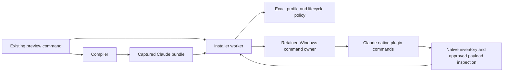

# Windows Claude user installation

## Outcome and present behavior

Qualify Claude Code 2.1.304 user installations on Windows x64 for `claude_code_v2`. This lets the existing `preview --target claude_code` command install, update and remove a development copy containing skills, supporting files and remote HTTP MCP declarations. The two qualified Windows Codex profiles remain unchanged.

The [normal activation pilot](windows-activation-acceptance.md) already installs, replaces and removes this format through the public SDK. Its Claude inventory checks run from one destination. They do not establish interruption recovery, discovery from two fresh projects or the compiled preview workflow. The current production profile table therefore rejects Windows Claude targets.

## Grounded flow

The preview command reads the existing plugin definition and asks the compiler for the client's package. `resolveTarget` in `src/installer/target/resolve.ts` canonicalizes the user home, reads the native client version and selects one exact entry from `nativeProfiles`. Physical home identity, host, scope and plugin determine the installation key. A user target has no project root.

`InstallerEngineLive` in `src/installer/lifecycle/engine.ts` owns planning, durable pending state and settlement. Its user operation holds one home lock. The ordinary recipe in `src/installer/lifecycle/recipe.ts` materializes the approved payload, publishes its local marketplace and runs two native commands per mutation: add marketplace/install, uninstall/install, or uninstall/remove marketplace. `runHost` uses the retained Windows command owner. Recovery observes those retained process births; resuming a pending plan cannot execute its recipe again.



Claude user settings, installed-plugin metadata and known-marketplace metadata differ from Codex TOML. The fixture must preserve unrelated JSON settings, confirm the owned native entries and inspect the actual reported payload path. Both fresh project directories must discover the same active user plugin and lose it after removal. Native `plugin list` and `plugin details` provide discovery without a model turn or remote MCP authentication.

## Alternatives and synthesis

| Shape | Decision |
| --- | --- |
| Add a Windows Claude installer service and expose a platform override to callers | Reject. This duplicates lifecycle and lock ownership, leaks qualification details and gives callers another installation path. |
| Keep the existing public compiler and installer; admit one profile only after bounded native qualification | Select. The public operation already hides capture, ownership, execution and recovery. Qualification supplies the missing evidence without another interface. |
| Admit the row from the previous normal SDK pilot alone | Reject. The missing interruption and compiled-command evidence would remain missing. |

The candidate adds exactly one entry: host `claude_code`, platform `win32`, version `2.1.304`, scope `user`, revision `claude-local-marketplace:1`, format `claude_code_v2`. Compatibility N1–N8 remain authoritative. Compare candidate selection and ownership with the actual Lean oracle before preparing an I/O snapshot. All existing profile decisions must retain their results.

## Private fixture contract and qualification

The fixture retains the established private operations; no public schema changes are planned:

```ts
declare function createFixture(stageRoot: string, caseId: string): Promise<Fixture>
declare function buildBundle(fixture: Fixture, generation: 1 | 2): Promise<Bundle>
declare function captureState(fixture: Fixture, target: Target, label: string): Promise<StoredState | null>
declare function inspectConfig(fixture: Fixture, target: Target, label: string): Promise<UserConfig>
declare function verifyForeign(fixture: Fixture, label: string): Promise<void>
declare function discover(fixture: Fixture, target: Target, bundle: Bundle | null, plan: ReadyPlan | null, label: string): Promise<void>
```

`UserConfig` records exact settings text and a parsed projection of unrelated settings. The target owns only its exact plugin selector and marketplace entries. Project settings and unrelated files remain byte exact. Native metadata entries must identify the expected user scope, marketplace, plugin version and approved payload. Settlement and completed replay preserve captured configuration and journal bytes.

Use the seven established cuts: before and after installation, replacement and removal, plus worker completion after caller termination. Reuse the accepted caller protocol, independent caller/worker admission and retained process-control implementation. The recovery snapshot receives only the candidate profile, the two existing engine checkpoints and standard worker tracing. Complete and independently validate each case before the next case or cleanup.

Compiled commands use a separate snapshot with only the profile and standard tracing. It must emit the actual `.js` worker and required JSON schemas. The normal sequence covers build, plan, show, apply, replacement, removal, unchanged planning and completed replay. A separate five-call preview sequence uses one stable source directory and unchanged authored identity: install, unchanged, changed source, remove and unchanged removal. Count all planning and applying workers. Unchanged results and replay enter execution zero times; each actual change enters once.

Select only the pinned Node, dependencies and Claude distribution from the original accepted activation root. The isolated stage must not depend on Codex being present. Preserve the original root and all earlier unknown stages. Exact process completion precedes closed-case evidence reads and inventories; job accounting alone is insufficient. Unknown completion prevents cleanup, retry and stage reuse.

Promote only the exact candidate profile bytes after recovery, compiled commands, preview, independent validation, retention and owned-stage cleanup pass. Then compare the live table with Lean, run the existing profile tests and scoped CLI/worker checks, update user docs and seal the successor evidence.

## Limits and phases

This qualification excludes Claude project scope, other versions and formats, bundled stdio, hooks, agents and explicit Windows repair. macOS, Grok native testing, third-party authentication, CI, package-consumer and release-wide checks retain their deferrals. A retained native counterexample requires a separate design and LDD change before product I/O changes.

- [x] Ground the current user recipe, profile selection, lock and accepted normal evidence.
- [x] Sketch complete alternatives and select the existing public interfaces.
- [x] Proceed under the instruction to complete the milestones.
- [x] Prove candidate profile conformance before preparing I/O inputs: 2,481 comparisons agree with Lean; two intended Windows queries become admitted and existing decisions remain unchanged.
- [ ] Accept the seven native interruption cases.
- [ ] Accept compiled normal commands and the preview lifecycle.
- [ ] Promote the exact profile, verify live behavior and seal the evidence.
- [ ] Reassess the design against observed native behavior.
